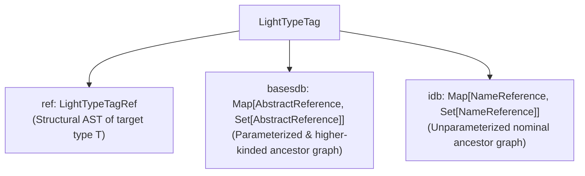

# Architecture, Internals & Design Trade-offs

`izumi-reflect` was designed by [Septimal Mind](https://7mind.io) to power runtime dependency injection ([`distage`](https://izumi.7mind.io/distage/)) and effect-system wiring in Scala 2 and Scala 3. Rather than exposing a general-purpose runtime mirror of the Scala compiler, `izumi-reflect` implements a compact, ahead-of-time-compiled model of the Scala type system tailored for three operations:

1. **Fast structural type equality and hashing** (`=:=`, `==`, `hashCode`) suitable for high-throughput lookup tables (`Map[LightTypeTag, Binding]`).
2. **Runtime subtype checking** (`<:<`) supporting variance, wildcards, intersections, unions, structural refinements, type aliases, opaque types, and higher-kinded types.
3. **Runtime higher-kinded type constructor application** (`combine`, `combineNonPos`) enabling tag materialization for polymorphic tagless-final modules (`F[_]: TagK`, `F[-_, +_, +_]: TagK3`).

---

## 1. Historical Context: Why `scala-reflect` `TypeTag` Was Replaced

Prior to `izumi-reflect`, Scala 2 applications relied on `scala.reflect.api.TypeTags.TypeTag` from `scala-reflect`. That design imposed four severe architectural constraints:

1. **Global Synchronization & Runtime Overhead**: `scala-reflect` reconstructs compiler `Symbol` and `Type` tables at runtime inside a mutable `Universe`. Concurrent `TypeTag` materialization and `<:<` checks contend on global compiler locks ([scala/bug#10766](https://github.com/scala/bug/issues/10766)) and execute orders of magnitude slower than structural ADT comparisons.
2. **Discontinuation in Scala 3**: Dotty / Scala 3 removed `scala-reflect` and `TypeTag` entirely in favor of compile-time `scala.quoted.Type` macros, leaving no built-in runtime type representation with subtyping support.
3. **No Native Higher-Kinded Type Combination**: In `scala-reflect`, a `WeakTypeTag[F[A]]` inside a polymorphic method `def bind[F[_], A]` contains unresolved type parameter symbols unless the caller manually splices `TypeTag` trees for concrete types; combining an arbitrary higher-kinded constructor `F[_]` with `A` at runtime is not supported by standard `TypeTag` implicit materialization.
4. **Heavy Platform & Footprint Dependencies**: `scala-reflect` requires a multi-megabyte JVM jar and cannot run on Scala.js, Scala Native, or GraalVM Native Image without extensive reflection configuration.

`izumi-reflect` solves all four problems by shifting compiler symbol traversal entirely to **compile time** (via `scala-reflect` macros on Scala 2 and `scala.quoted` `Quotes` reflection on Scala 3) and emitting an immutable, platform-independent [`LightTypeTag`](https://github.com/zio/izumi-reflect/blob/develop/izumi-reflect/izumi-reflect/src/main/scala/izumi/reflect/macrortti/LightTypeTag.scala).

---

## 2. The Three-Part `LightTypeTag` Representation

Every [`LightTypeTag`](https://github.com/zio/izumi-reflect/blob/develop/izumi-reflect/izumi-reflect/src/main/scala/izumi/reflect/macrortti/LightTypeTag.scala) consists of three components (inspectable via `LightTypeTagUnpacker(tag)`):

```scala
abstract class LightTypeTag(
  bases: () => Map[AbstractReference, Set[AbstractReference]],
  inheritanceDb: () => Map[NameReference, Set[NameReference]]
) extends Serializable {
  def ref: LightTypeTagRef
  private[reflect] lazy val basesdb: Map[AbstractReference, Set[AbstractReference]] = bases()
  private[reflect] lazy val idb: Map[NameReference, Set[NameReference]] = inheritanceDb()
}
```



### 2.1 `ref: LightTypeTagRef` — The Structural Type AST

[`LightTypeTagRef`](https://github.com/zio/izumi-reflect/blob/develop/izumi-reflect/izumi-reflect/src/main/scala/izumi/reflect/macrortti/LightTypeTagRef.scala) is a sealed ADT modeling the syntax of a dealiased Scala type:

- **`AbstractReference`**: Top-level reference node; either a `Lambda` or an `AppliedReference`.
  - **`Lambda(input: List[LambdaParamName], output: AbstractReference)`**: A type constructor or type lambda (e.g., `λ %0 → scala.collection.immutable.List[+%0]`).
  - **`AppliedReference`**: Any proper (fully applied) type expression:
    - **`AppliedNamedReference`**:
      - **`NameReference(ref: SymName, boundaries: Boundaries, prefix: Option[AppliedReference])`**: An unparameterized nominal type, singleton/term reference, literal constant (`SymLiteral`), or bounded abstract type member.
      - **`FullReference(symName: SymName, parameters: List[TypeParam], prefix: Option[AppliedReference])`**: A parameterized type application pairing a constructor symbol with variance-annotated `TypeParam(ref: AbstractReference, variance: Variance)` arguments.
    - **`IntersectionReference(refs: Set[AppliedReference])`**: Normalized conjunction `A with B` / `A & B` with tautologies (`Any`, `AnyRef`, `Object`) stripped.
    - **`UnionReference(refs: Set[AppliedReference])`**: Normalized disjunction `A | B` with `Nothing` stripped.
    - **`Refinement(reference: AppliedReference, decls: Set[RefinementDecl])`**: Structural refinement holding `RefinementDecl.Signature(name, input, output)` for methods/vals and `RefinementDecl.TypeMember(name, ref)` for type members.
    - **`WildcardReference(boundaries: Boundaries)`**: Existential/wildcard argument `? <: Upper >: Lower`.

### 2.2 `basesdb: Map[AbstractReference, Set[AbstractReference]]` — Parameterized & Higher-Kinded Base Database

`basesdb` records how type parameters and variances flow from every type and type constructor appearing in `T` to its supertypes. It contains two kinds of keys:

1. **Applied parameterized references (`FullReference` / `NameReference`)**: For a concrete application such as `Either[String, Int]`, `basesdb` stores its instantiated supertypes (`Product`, `Serializable`, `Equals`).
2. **Unapplied type constructor lambdas (`Lambda`)**: For every parameterized class in the hierarchy (e.g., `List[+A]`), `basesdb` stores a `Lambda` key mapping the constructor to its supertype constructors parameterized by the same lambda parameters (e.g., `λ %0 → List[+%0] -> Set(λ %0 → Seq[+%0], λ %0 → IterableOps[+%0, +List, +List[%0]], ...)`).

### 2.3 `idb: Map[NameReference, Set[NameReference]]` — Unparameterized Nominal Inheritance Database

`idb` maps unparameterized `NameReference`s to their transitive nominal supertypes (classes, traits, and upper bounds of abstract type members).

### 2.4 Why Both `basesdb` and `idb` Are Required

Separating `basesdb` and `idb` avoids both redundancy and loss of variance precision:

- When checking `List[Int] <:< Seq[AnyVal]`, `LightTypeTagInheritance.compareParameterizedRefs` must know how the type argument `Int` of `List` maps into the type parameter of `Seq` and with what variance (`+A`). That mapping lives in `basesdb`.
- When checking `List[Int] <:< Serializable` or `SubStrA <:< String` (where the target `NameReference` has no type parameters), `LightTypeTagInheritance.isSameOrSubTypeOfNameRef` queries `idb` (`unparameterizedParentsOf`) directly without constructing or rewriting dummy type lambdas.

---

## 3. Alpha-Equivalence & De Bruijn Lambda Normalization

A central challenge in compile-time type reflection is that equivalent type lambdas inspected at different call sites—or synthesized at runtime by `TagMacro`—carry different compiler parameter symbols. For example:

- `LTT[_][List]` inspected directly produces a `Lambda` whose parameter was created at macro depth `0`.
- A nested type lambda `OptionT[Either[A, *], B]` produces inner `Lambda` parameters at depth `1` or `2`.
- `TagMacro` synthesizes complex combination lambdas using `LambdaConstants.tagMacro = -3`.

To make `Lambda.equals`, `Lambda.hashCode`, and `<:<` invariant under alpha-renaming of bound parameters, [`SymName.LambdaParamName`](https://github.com/zio/izumi-reflect/blob/develop/izumi-reflect/izumi-reflect/src/main/scala/izumi/reflect/macrortti/LightTypeTagRef.scala) uses positional indices:

```scala
final case class LambdaParamName(index: Int, depth: Int, arity: Int) extends SymName
```

When two `Lambda`s are compared (`Lambda.equals`) or hashed (`Lambda.hashCode`), `Lambda.normalizedOutput` rewrites the bound `input` parameters into canonical fake parameters at reserved depth `LambdaConstants.lambdaFakeParamDepth = -2`:

```scala
lazy val normalizedOutput: AbstractReference = {
  if (input.isEmpty) output
  else RuntimeAPI.applyLambda(this, makeFakeParams)
}
```

Because `makeFakeParams` depends only on the `input.size` (arity) and positional index `0 .. arity - 1`, any two alpha-equivalent type lambdas normalize to structurally identical `normalizedOutput` trees.

---

## 4. Compile-Time Inspection Pipeline (Scala 2 vs Scala 3)

Although Scala 2 and Scala 3 have completely different compiler APIs, both target the exact same `LightTypeTag` runtime model through parallel inspection pipelines:

| Stage | Scala 2 (`scala-reflect`) | Scala 3 (`scala.quoted` Quotes) |
| :--- | :--- | :--- |
| **Macro Entry Point** | `LightTypeTagMacro0` / `TagMacro` | `Inspect` / `TagMacro` |
| **Normalization & Dealiasing** | `ReflectionUtil.norm` | `ReflectionUtil._dealiasSimplifiedFull` |
| **Target AST Extraction** | `LightTypeTagImpl.inspectType` | `Inspector.inspectTypeRepr` |
| **Parameterized `basesdb` Pass** | `LightTypeTagImpl.makeBaseClassesDb` | `FullDbInspector.makeFullDb` |
| **Nominal `idb` Pass** | `LightTypeTagImpl.makeInheritanceDb` | `InheritanceDbInspector.makeUnappliedInheritanceDb` |

During compile-time inspection:

1. **Dealiasing & Singleton Normalization**: Type aliases are expanded (`dealias`), except when a singleton/term prefix or opaque type boundary must be preserved. On Scala 3, opaque type aliases are inspected as bounded `NameReference`s inside their defining scope and as distinct nominal types outside it.
2. **Intersection & Union Canonicalization**: `IntersectionReference` and `UnionReference` flatten nested `AndType` / `OrType` / `RefinedType` trees, strip top-type tautologies (`Any`, `AnyRef`, `Object` in intersections; `Nothing` in unions), and collapse single-element sets back into plain `AppliedReference`s.
3. **Compile-Time Caching**: On Scala 2, setting `-Dizumi.reflect.rtti.cache.compile=true` caches inspected `LightTypeTag` components across macro expansions within the same compiler universe.

---

## 5. Binary Serialization, Shaded `BooPickle`, and Lazy Deserialization

### 5.1 Why Binary Pickling Into `ISO_8859_1` Strings Was Chosen

If a macro emitted Scala AST construction code (`FullReference("scala.List", List(TypeParam(...)))`) directly into the call site for every `Tag[T]`, complex domain types with deep inheritance graphs (`basesdb` + `idb`) would generate ribuan-instruction methods, frequently exceeding the JVM's `64 KB` method bytecode limit and inflating `.class` files.

Instead, `izumi-reflect` serializes `ref` and `SubtypeDBs(basesdb, idb)` **at compile time** using an internal, shaded copy of `BooPickle` (`izumi.reflect.thirdparty.internal.boopickle`) and encodes the raw `ByteBuffer` bytes into two `ISO_8859_1` `String` literals embedded in bytecode:

```scala
LightTypeTag.parse[T](
  hashCode = 14829104,
  refString = "...",   // BooPickle-encoded LightTypeTagRef
  basesString = "...", // BooPickle-encoded SubtypeDBs(basesdb, idb)
  version = 30         // LightTypeTag.currentBinaryFormatVersion
)
```

Why `ISO_8859_1` strings and shaded `BooPickle`?
- **`ISO_8859_1` 1-to-1 Byte Mapping**: Every byte `0x00..0xFF` maps bijectively to a single Unicode code point `U+0000..U+00FF`, avoiding Base64 expansion overhead while remaining a valid JVM/JS/Native constant-pool `String`.
- **Zero External Dependencies**: Shading a minimal `BooPickle` subset avoids pulling external serialization libraries into downstream dependency trees and works identically on JVM, Scala.js, Scala Native, and GraalVM Native Image.

### 5.2 Lazy Deserialization & `O(1)` Equality in `ParsedLightTypeTag230Plus`

At runtime, `LightTypeTag.parse` returns a [`ParsedLightTypeTag230Plus`](https://github.com/zio/izumi-reflect/blob/develop/izumi-reflect/izumi-reflect/src/main/scala/izumi/reflect/macrortti/LightTypeTag.scala) (for binary format version `>= 30`, introduced in `izumi-reflect` `2.3.0`):

- **`hashCode` is precomputed at compile time** and stored as an `Int` field. Hashing a `ParsedLightTypeTag230Plus` requires **zero** deserialization.
- **`ref`, `basesdb`, and `idb` are `lazy val`s**: `refString` is only unpickled if structural inspection (`ref`, `<:<`, `combine`, `repr`) is invoked; `basesString` is only unpickled if subtype checking (`<:<`) or runtime combination (`combine`) is invoked.
- **`O(1)` String-Literal Equality Fast Path**: When `-Dizumi.reflect.rtti.optimized.equals=true` (the default), comparing two `ParsedLightTypeTag230Plus` instances checks `if (this.refString == that.refString) true` **before** touching `ref`. If both tags were compiled for the same concrete type, equality succeeds via a single `String.equals` check without ever running `BooPickle`.

### 5.3 Cross-Version Binary Compatibility (`ParsedLightTypeTagOldOrPre230`)

In `izumi-reflect` `2.3.0` (binary format version `30`), `SymName.LambdaParamName` replaced raw `String` names for lambda parameters. Because a pre-2.3.0 artifact (`version < 30`) and a 2.3.0+ artifact have different binary `refString` encodings and precomputed `hashCode`s for the same type lambda, `LightTypeTag.parse` instantiates `ParsedLightTypeTagOldOrPre230` whenever `version < 30`. That fallback class disables the `refString` fast-path and recomputes `hashCode = ref.hashCode() * 31` from the deserialized `ref` AST, preserving the `equals`/`hashCode` contract across binary-compatible upgrades.

---

## 6. Polymorphic `Tag[T]` Materialization & Runtime Type Combination

### 6.1 Strong vs Weak Types in `TagMacro`

When `Tag[T]` is summoned, `TagMacro` (both [Scala 2](https://github.com/zio/izumi-reflect/blob/develop/izumi-reflect/izumi-reflect/src/main/scala-2/izumi/reflect/TagMacro.scala) and [Scala 3](https://github.com/zio/izumi-reflect/blob/develop/izumi-reflect/izumi-reflect/src/main/scala-3/izumi/reflect/TagMacro.scala)) first checks `ReflectionUtil.allPartsStrong(tpe)`:

- **Strong Type** (contains no unresolved type parameters or abstract type members owned by an enclosing method/class): `TagMacro` immediately inspects `T` at compile time and emits `Tag.apply(classOf[...], LightTypeTag.parse(...))`.
- **Weak / Polymorphic Type** (contains unresolved type parameters, e.g., `F[Either[Int, A]]`): `TagMacro` recursively decomposes the type structure and emits runtime assembly calls:
  - Applied types (`F[A]`): summons `HKTag[F]` (or `Tag[F]` on Scala 3) and `Tag[A]`, emitting `Tag.appliedTag(ctorTag, List(argTag.tag))`.
  - Partial applications / type lambdas (`[X] =>> F[Int, X]`): emits `Tag.appliedTagNonPos(ctorTag, List(Some(LTT[Int]), None))`.
  - Non-trivial type lambdas with reordered, duplicated, or nested parameters (`[X] =>> F[X, G[X], X]`): synthesizes a `ctorApplyingLambda` at depth `LambdaConstants.tagMacro = -3` and emits `Tag.appliedTagNonPosAux`.
  - Intersections, Unions, and Refinements with weak type members: emits `Tag.refinedTag` or `Tag.unionTag`.

### 6.2 Why `HKTag` Uses Structural `Arg` on Scala 2 vs `AnyKind` on Scala 3

Scala 2's type system does not support polymorphic kind bounds (`T <: AnyKind`). Consequently, a single trait `Tag[T]` on Scala 2 can only accept proper types (`*`). To represent higher-kinded type constructors of arbitrary kinds without generating $2^N$ separate traits, Scala 2 defines `HKTag[T]` where `T` is a structural refinement wrapping the type constructor in a type member `Arg`:

```scala
// Scala 2 encoding of TagK[K[_]]:
type TagK[K[_]] = HKTag[{ type Arg[A] = K[A] }]
```

At compile time, `LightTypeTagMacro0.unpackArgStruct` extracts the poly-type signature of `Arg` and inspects it as a `LightTypeTagRef.Lambda`. Furthermore, `Tag.auto.T[K]` on Scala 2 uses a whitebox macro (`TagLambdaMacro`) to inspect the kind of `K` from the enclosing AST and synthesize the matching `{ type T[K[...]] = HKTag[{ type Arg[...] = K[...] }] }` structural type on the fly.

On Scala 3, native kind polymorphism (`trait Tag[T <: AnyKind]`) eliminates the structural wrapper entirely: `HKTag`, `TagK`, `TagKK`, `TagT`, and `Tag.auto.T` are zero-cost type aliases for `Tag[T]`.

### 6.3 How `LightTypeTag.combine` and `RuntimeAPI.Rewriter` Work

When `outer.combine(args: _*)` is executed at runtime:

1. **`ref` Rewriting**: `outer.ref` (which must be a `Lambda`) binds its `input` `LambdaParamName`s to the provided `args` in a substitution map `context: Map[SymName, AbstractReference]` and runs `RuntimeAPI.Rewriter.replaceRefs(output)`.
2. **Higher-Kinded Head Substitution (`#82`, `#83`)**: If a `LambdaParamName` appears in the constructor head position of a `FullReference(head, parameters, prefix)` (e.g., applying `[F[_]] =>> F[Int]` to `Option`), `Rewriter.replaceNamed` sees that `Option` is itself a `Lambda`, applies `Option`'s lambda to `parameters.map(_.ref)` (`Int`), and recursively runs `replaceRefs` on the resulting `AbstractReference`.
3. **`basesdb` Rewriting & Unapplied Base Lambda Retention**: `LightTypeTag.combinedBasesdb` rewrites `Lambda` keys and parent values in `basesdb` using the provided arguments, **and intentionally retains the original unapplied `Lambda -> Set[Lambda]` entries alongside the newly applied ones**:
   ```scala
   // Retaining unapplied base lambdas in basesdb is required so that
   // LightTypeTagInheritance.compareParameterizedRefs can still synthesize
   // appliedLambdaParents when checking subtyping against higher-kinded ancestors.
   ```
4. **Database Merging**: `LightTypeTag.mergeIDBs` takes the union of `basesdb` and `idb` across the outer tag and all argument tags so that subtype relationships of every type argument remain available in the combined `LightTypeTag`.

---

## 7. Subtype Checking Engine (`LightTypeTagInheritance`)

When `self <:< that` is called, [`LightTypeTagInheritance`](https://github.com/zio/izumi-reflect/blob/develop/izumi-reflect/izumi-reflect/src/main/scala/izumi/reflect/macrortti/LightTypeTagInheritance.scala) constructs a `Ctx` holding the lazily merged inheritance databases of both tags (`self.basesdb ++ that.basesdb` and `self.idb ++ that.idb`) and evaluates `isChild(self.ref, that.ref)` according to the following rules:

1. **Structural Equality Fast Path**: If `selfT0 == thatT0`, returns `true`.
2. **Universal Top & Bottom Short-Circuits**:
   - `scala.Nothing` and `scala.Null` are subtypes of all non-lambda references.
   - All non-lambda references are subtypes of `scala.Any`, `scala.AnyRef`, `java.lang.Object`, and `scala.Matchable`.
3. **Wildcards & Type Bounds (`Boundaries.Defined(bottom, top)`)**:
   - `self <:< WildcardReference(Defined(low, high))` holds iff `low <:< self` and `self <:< high`.
   - A bounded `NameReference` or `FullReference` on the left conforms if its upper bound `<:< that`; on the right, if `self <:<` its lower bound.
4. **Intersections & Unions**:
   - `Intersection(A, B) <:< T` holds if any member `<:< T`; `T <:< Intersection(A, B)` holds if `T <:<` **all** members.
   - `Union(A, B) <:< T` holds if **all** members `<:< T`; `T <:< Union(A, B)` holds if `T <:<` any member.
5. **Type Lambdas (`Lambda <:< Lambda`)**:
   - Requires equal arity (`s.input.size == o.input.size`).
   - Instantiates both lambdas with fresh `WildcardReference`s (when parameter bounds exist) or canonical `makeFakeParams`, checks `appliedSelf <:< appliedThat`, and verifies that every parameter referenced in `that` is either unused in `self` or conforms in both covariant and contravariant directions.
6. **Parameterized References (`compareParameterizedRefs(self: FullReference, that: FullReference)`)**:
   - **Step A (Same Constructor)**: If `self.asName == that.asName`, checks `parametersConform` pairwise according to `that.parameters` variance (`Invariant` -> `=:=`, `Covariant` -> `selfParam <:< thatParam`, `Contravariant` -> `thatParam <:< selfParam`).
   - **Step B (Instantiated Parents in `basesdb`)**: Checks whether any `FullReference` parent of `self` in `basesdb` conforms to `that`.
   - **Step C (Higher-Kinded Lambda Parents in `basesdb`)**: Searches `basesdb` for unapplied `Lambda` keys matching `self.asName`, applies those parent `Lambda`s to `self.parameters`, and recursively checks whether any resulting `appliedLambdaParent <:< that`.

---

## 8. Deliberate Design Decisions, Sacrifices & Soundness Trade-offs

`izumi-reflect` is not a full theorem prover for the Scala type system. Several soundness properties of the compiler's internal typechecker were deliberately sacrificed in exchange for finite ahead-of-time serialization, small bytecode size, and sub-microsecond runtime checks.

### 8.1 Cycle Termination in F-Bounded Polymorphism (`basesTermination`)

- **What happens**: When inspecting recursive/F-bounded types such as `trait Enum[E <: Enum[E]]` or `java.lang.Comparable[T]`, `LightTypeTagImpl` (Scala 2) and `FullDbInspector` / `InheritanceDbInspector` (Scala 3) track visited class symbols in a `basesTermination: Set[Symbol]` accumulator and stop expanding base types as soon as a symbol repeats. Furthermore, self-referential upper bounds are stripped to `Boundaries.Empty` to prevent infinite recursion during serialization and `<:<` traversal.
- **What was sacrificed & why**: Because `basesdb` and `idb` are computed ahead of time into finite maps, infinite unfolding of recursive F-bounds is impossible without lazy runtime compiler mirrors. Terminating at the first cycle guarantees macro termination and bounded binary tag sizes while still supporting direct F-bounded subtype checks.

### 8.2 Conflation of `Any` / `AnyRef` / `Object` / `Matchable` and `Nothing` / `Null`

- **What happens**: `LightTypeTagInheritance` treats `scala.Any`, `scala.AnyRef`, `java.lang.Object`, and `scala.Matchable` as interchangeable top types, and treats `scala.Nothing` and `scala.Null` as interchangeable bottom types. Consequently, `LTT[Int] <:< LTT[AnyRef]`, `LTT[Int] <:< LTT[Matchable]`, and `LTT[Null] <:< LTT[Int]` all evaluate to `true`.
- **What was sacrificed & why**: In the Scala specification, `AnyVal` primitives do not inherit from `AnyRef`, and `Null` is only a subtype of `AnyRef`s. However, on the JVM, generic type parameters erase to `java.lang.Object`, and Scala 2's reflection APIs frequently leak `Object` or `AnyRef` in upper bounds of unconstrained type parameters. Recording `AnyRef` vs `AnyVal` exclusions in every `idb` entry would inflate serialized tags and break common erased/generic bound comparisons without providing value for DI wiring keys.

### 8.3 Omission of Lower Bounds on Abstract Higher-Kinded Type Members

- **What happens**: For an abstract higher-kinded type member `type F[A] >: Lower[A] <: Upper[A]`, compile-time inspection (`LightTypeTagImpl:388` and `Inspector.inspectBounds`) discards `Lower` and records only `Upper` as a `Lambda` inside `Boundaries.Defined(Nothing, UpperLambda)`.
- **What was sacrificed & why**: Representing both lower and upper higher-kinded bounds with potentially different lambda parameter bindings inside `Boundaries.Defined` complicates lambda normalization and boundary comparison, while lower-bounded higher-kinded abstract type members are virtually nonexistent in real-world Scala codebases.

### 8.4 Asymmetric Structural Refinements & Omission of Concrete Class Member Tables (`#481`)

- **What happens**:
  1. For a concrete class `class Foo { def bar: Int = 1 }`, `LTT[Foo]` records only the nominal class `Foo` and its supertypes—it does **not** record `def bar: Int` in a `Refinement`. Therefore, `LTT[Foo] <:< LTT[{ def bar: Int }]` returns `false` unless `Foo` was explicitly typed as an intersection/refinement containing `{ def bar: Int }`.
  2. In `TagMacro`, weak type parameters inside structural *type members* (`Tag[Any { type Out = A }]`) are resolved at runtime via `additionalTypeMembers`, whereas weak type parameters inside structural *method or val signatures* (`Tag[{ def get: A }]`) are not resolved.
- **What was sacrificed & why**: Serializing the complete method and field symbol table of every concrete class (`String`, `List`, domain services) into `LightTypeTag` would multiply bytecode size by 10x–50x and turn `LightTypeTag` into a heavyweight runtime mirror. `izumi-reflect` therefore tracks structural declarations only when they are explicitly written as a Scala refinement type.

### 8.5 Name-Based Path-Dependent Types and `this.type` Erasure

- **What happens**: Path-dependent prefixes (`a.Out` vs `b.Out`) are stored using term symbol names (`SymTermName("x.a")`) without compiler symbol IDs, and `X.this.type` is normalized to the enclosing class `X`.
- **What was sacrificed & why**: Compiler symbol IDs are ephemeral across separate compilation units and JVM runs. Using deterministic symbol strings allows `LightTypeTag`s compiled in separate modules or processes to have identical `refString` representations and `hashCode`s, at the cost of conflating two distinct local variables that happen to share the same name and scope path.

### 8.6 Unbounded Parameter Requirement for `TagK` / `HKTag`

- **What happens**: Summoning `TagK[Abc]` directly for a type constructor with bounded type parameters (`class Abc[S <: String]`) fails to compile, whereas partially applying the bounded parameter (`class Abc[S <: String, A]; TagK[Abc["hi", *]]`) succeeds.
- **What was sacrificed & why**: Higher-kinded tag synonyms (`type TagK[K[_]]`) require a type constructor accepting an unbounded parameter `[_]`. Scala's kind system does not permit abstracting over arbitrary parameter bounds inside a single fixed `TagK[K[_]]` type alias without dependent kind polymorphism.
